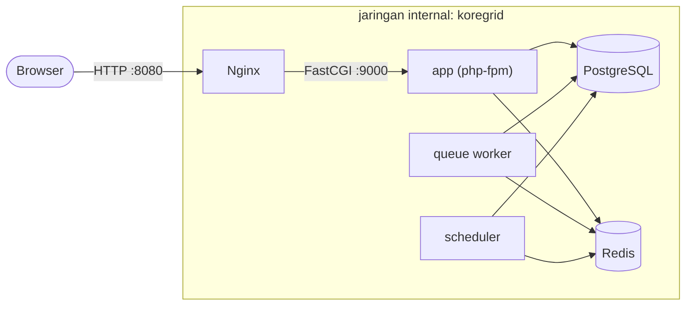
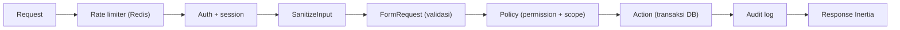

# KoreGrid: Architecture

## 1. Topologi Docker Compose

| Service | Peran |
|---|---|
| nginx | Satu-satunya service yang membuka port ke host. Menambahkan security header. |
| app | php-fpm, menjalankan request web. |
| queue | Worker untuk invoice dan job asynchronous. |
| scheduler | Menjalankan job terjadwal, termasuk expiry reservasi stok. |
| postgres | Data transaksional. Tidak terekspos ke host. |
| redis | Cache, session, queue, rate limiter. Tidak terekspos ke host, wajib password. |

`app`, `queue`, dan `scheduler` memakai satu image yang sama (target `development` di lokal, `production` di CI/CD).

Catatan production: Nginx perlu akses ke `public/`. Di production, bake image Nginx terpisah yang menyalin `public/` dari image `production`, bukan bind mount.

## 2. Alur Request

Controller hanya menghubungkan langkah-langkah ini. Aturan bisnis ada di Action, otorisasi di Policy.

## 3. RBAC

Memakai `spatie/laravel-permission`. Semua hak akses diberikan lewat role, tidak ada permission langsung ke user.

- `super_admin` diberi akses penuh lewat `Gate::before`, bukan dengan menyalin semua permission.
- Policy memeriksa dua hal: **permission** (boleh melakukan aksi ini?) dan **scope** (terhadap data ini?).

### Matriks permission

| Permission | Super Admin | Finance | Warehouse Staff | Buyer |
|---|:-:|:-:|:-:|:-:|
| `product.view` | ✓ | ✓ | ✓ | ✓ |
| `product.manage` | ✓ | | | |
| `inventory.view` | ✓ | ✓ | ✓ | |
| `inventory.adjust` | ✓ | | ✓ | |
| `po.create` | ✓ | | | ✓ |
| `po.view.own` | ✓ | | | ✓ |
| `po.view.all` | ✓ | ✓ | ✓ | |
| `po.submit` | ✓ | | | ✓ |
| `po.cancel` | ✓ | | | ✓ |
| `po.approve` | ✓ | ✓ | | |
| `po.reject` | ✓ | ✓ | | |
| `po.pack` | ✓ | | ✓ | |
| `po.ship` | ✓ | | ✓ | |
| `po.complete` | ✓ | | | ✓ |
| `invoice.view` | ✓ | ✓ | | ✓ |
| `invoice.download` | ✓ | ✓ | | ✓ |
| `user.manage` | ✓ | | | |
| `company.manage` | ✓ | | | |
| `role.manage` | ✓ | | | |
| `audit.view` | ✓ | ✓ | | |

Asumsi yang perlu dikonfirmasi: `po.complete` dipegang Buyer (konfirmasi barang diterima).

### Aturan scope

| Role | Data yang boleh diakses |
|---|---|
| Buyer | PO milik `company_id` yang sama dengan user. |
| Warehouse Staff | Inventori dan PO yang item-nya berasal dari `warehouse_id` miliknya. |
| Finance, Super Admin | Semua. |

## 4. Siapa Boleh Memindahkan Status PO

| Transisi | Permission | Efek stok |
|---|---|---|
| draft → pending_approval | `po.submit` | reservasi dikonfirmasi |
| pending_approval → approved | `po.approve` | |
| pending_approval → rejected | `po.reject` | release |
| draft / pending_approval → cancelled | `po.cancel` | release |
| approved → packing | `po.pack` | |
| packing → shipped | `po.ship` | commit (on_hand dan reserved berkurang) |
| shipped → completed | `po.complete` | invoice dibuat |

## 5. Lapisan Keamanan

| Kontrol | Implementasi |
|---|---|
| Rate limiting | Named limiter berbasis Redis: `login` (per email + IP), `api` (per user), `po-submit` (per user). |
| Input sanitization | FormRequest untuk validasi tipe dan panjang. Field teks bebas di-trim dan di-strip tag. Query lewat Eloquent (parameter binding). Vue memakai interpolasi `{{ }}`, tanpa `v-html`. |
| Audit trail | Observer untuk model sensitif plus log eksplisit untuk perubahan status. Tabel append-only (lihat `DATA-MODEL.md`). |
| Secret | Hanya dari `.env`. Compose gagal start jika secret kosong. Image tidak memuat `.env`. |
| Container | Image runtime berjalan sebagai non-root (`www-data`). Postgres dan Redis tidak punya port publik. |
| Supply chain | `composer audit`, `npm audit`, dan Trivy di CI. |

## 6. Layer Aplikasi

`Http → Application → Domain`. `Infrastructure` mengimplementasikan Contract dari `Domain`. Aturan ini dienforce dengan test arsitektur (Pest Arch) di CI.

## 7. Keputusan Arsitektur

| Keputusan | Alasan | Konsekuensi |
|---|---|---|
| Spatie untuk RBAC | Teruji luas, hemat waktu | Tabel RBAC mengikuti skema Spatie |
| Tabel `companies` | B2B nyata: tier milik perusahaan | `users.company_id`, `purchase_orders.company_id` |
| Snapshot harga di PO | Perubahan tier atau harga tidak mengubah PO lama | Kolom `unit_price`, `moq_applied`, `pricing_tier` di PO |
| CHECK constraint untuk stok | Integritas tidak bergantung pada kode aplikasi | Pelanggaran muncul sebagai error DB, ditangkap Action |
| Eloquent di `Domain` | Pragmatis untuk Laravel | Boundary dijaga lewat Action classes |
