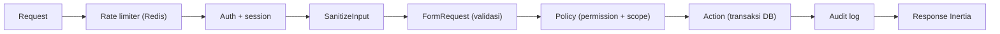

# KoreGrid: Architecture

## 1. Topologi Docker Compose

| Service | Peran |
|---|---|
| nginx | Satu-satunya service yang membuka port ke host. Menambahkan security header. |
| app | php-fpm, menjalankan request web. |
| queue | Worker untuk invoice dan job asynchronous. |
| scheduler | Menjalankan job terjadwal, termasuk expiry reservasi stok. |
| postgres | Data transaksional. Tidak terekspos ke host. |
| redis | Cache, session, queue, rate limiter. Tidak terekspos ke host, wajib password. |

`app`, `queue`, dan `scheduler` memakai satu image yang sama (target `development` di lokal, `production` di CI/CD).

Catatan production: Nginx perlu akses ke `public/`. Di production, bake image Nginx terpisah yang menyalin `public/` dari image `production`, bukan bind mount.

## 2. Alur Request

Controller hanya menghubungkan langkah-langkah ini. Aturan bisnis ada di Action, otorisasi di Policy.

## 3. RBAC

Memakai `spatie/laravel-permission`. Semua hak akses diberikan lewat role, tidak ada permission langsung ke user.

- `super_admin` diberi akses penuh lewat `Gate::before`, bukan dengan menyalin semua permission.
- Policy memeriksa dua hal: **permission** (boleh melakukan aksi ini?) dan **scope** (terhadap data ini?).

### Matriks permission

| Permission | Super Admin | Finance | Warehouse Staff | Buyer |
|---|:-:|:-:|:-:|:-:|
| `product.view` | ✓ | ✓ | ✓ | ✓ |
| `product.manage` | ✓ | | | |
| `inventory.view` | ✓ | ✓ | ✓ | |
| `inventory.adjust` | ✓ | | ✓ | |
| `po.create` | ✓ | | | ✓ |
| `po.view.own` | ✓ | | | ✓ |
| `po.view.all` | ✓ | ✓ | ✓ | |
| `po.submit` | ✓ | | | ✓ |
| `po.cancel` | ✓ | | | ✓ |
| `po.approve` | ✓ | ✓ | | |
| `po.reject` | ✓ | ✓ | | |
| `po.pack` | ✓ | | ✓ | |
| `po.ship` | ✓ | | ✓ | |
| `po.complete` | ✓ | | | ✓ |
| `invoice.view` | ✓ | ✓ | | ✓ |
| `invoice.download` | ✓ | ✓ | | ✓ |
| `user.manage` | ✓ | | | |
| `company.manage` | ✓ | | | |
| `role.manage` | ✓ | | | |
| `audit.view` | ✓ | ✓ | | |

Asumsi yang perlu dikonfirmasi: `po.complete` dipegang Buyer (konfirmasi barang diterima).

### Aturan scope

| Role | Data yang boleh diakses |
|---|---|
| Buyer | PO milik `company_id` yang sama dengan user. |
| Warehouse Staff | Inventori dan PO yang item-nya berasal dari `warehouse_id` miliknya. |
| Finance, Super Admin | Semua. |

## 4. Siapa Boleh Memindahkan Status PO

| Transisi | Permission | Efek stok |
|---|---|---|
| draft → pending_approval | `po.submit` | reservasi dikonfirmasi |
| pending_approval → approved | `po.approve` | |
| pending_approval → rejected | `po.reject` | release |
| draft / pending_approval → cancelled | `po.cancel` | release |
| approved → packing | `po.pack` | |
| packing → shipped | `po.ship` | commit (on_hand dan reserved berkurang) |
| shipped → completed | `po.complete` | invoice dibuat |

## 5. Lapisan Keamanan

| Kontrol | Implementasi |
|---|---|
| Rate limiting | Named limiter berbasis Redis: `login` (per email + IP), `api` (per user), `po-submit` (per user). |
| Input sanitization | FormRequest untuk validasi tipe dan panjang. Field teks bebas di-trim dan di-strip tag. Query lewat Eloquent (parameter binding). Vue memakai interpolasi `{{ }}`, tanpa `v-html`. |
| Audit trail | Observer untuk model sensitif plus log eksplisit untuk perubahan status. Tabel append-only (lihat `DATA-MODEL.md`). |
| Secret | Hanya dari `.env`. Compose gagal start jika secret kosong. Image tidak memuat `.env`. |
| Container | Image runtime berjalan sebagai non-root (`www-data`). Postgres dan Redis tidak punya port publik. |
| Supply chain | `composer audit`, `npm audit`, dan Trivy di CI. |

## 6. Layer Aplikasi

`Http → Application → Domain`. `Infrastructure` mengimplementasikan Contract dari `Domain`. Aturan ini dienforce dengan test arsitektur (Pest Arch) di CI.

## 7. Alur Use Case: Membuat Draft PO

Action `CreateDraftPurchaseOrder` (lapisan Application) bekerja dalam satu transaksi database:

- Memeriksa pembeli dan perusahaannya aktif, lalu menggabungkan baris kembar dan mengurutkannya.
- Memuat produk dan memastikan gudang aktif.
- Menentukan harga dan MOQ dari tier **perusahaan** pembeli. MOQ dibandingkan dengan jumlah total produk itu di semua gudang.
- Mengunci stok per item lewat `ReserveStock` (satu UPDATE atomik dengan syarat di WHERE).
- Menghitung subtotal, PPN (default 11%, `KOREGRID_TAX_RATE`), dan total dengan aritmetika desimal string (bcmath).
- Menyimpan PO beserta item yang membawa snapshot harga dan MOQ, lalu menulis audit log `created`.

Kegagalan di langkah mana pun (MOQ, stok, harga) membatalkan seluruh transaksi: tidak ada PO, reservasi, atau audit yang tersisa. Perubahan status selanjutnya hanya lewat `TransitionPurchaseOrder`, yang memvalidasi state machine dan menulis audit `status_changed`.

Tanpa framework HTTP di lapisan ini: Domain tidak boleh bergantung pada Http, Application, maupun Infrastructure. Audit log ditulis lewat kontrak `AuditRecorder` (Domain) yang diimplementasikan `DatabaseAuditRecorder` (Infrastructure).

## 8. Alur Persetujuan dan Otorisasi

Setiap langkah alur PO adalah satu use case di lapisan Application. Semuanya berpola sama dan berjalan dalam satu transaksi:

1. Mengunci baris PO (`SELECT ... FOR UPDATE`), sehingga dua aksi yang berebut PO yang sama berjalan bergantian dan keputusan dibuat dari status terbaru.
2. Memeriksa otorisasi lewat `PurchaseOrderPolicy`: permission dari role **dan** cakupan data.
3. Mengubah status lewat `TransitionPurchaseOrder` (state machine + audit dengan aktor yang eksplisit).
4. Menjalankan efek samping (melepas atau mengeluarkan stok, menerbitkan invoice). Kegagalan di langkah mana pun membatalkan semuanya.

Aturan cakupan data:

- Buyer hanya bertindak atas PO milik perusahaannya sendiri. Ini mencegah buyer perusahaan lain menyentuh PO yang bukan miliknya.
- Warehouse Staff yang terikat gudang hanya bertindak atas PO yang memuat barang dari gudangnya. Staf tanpa gudang tetap bertindak untuk semua gudang. Pengiriman masih per PO, bukan per gudang; pengiriman parsial per gudang adalah pengembangan berikutnya.
- Finance dan Super Admin tidak dibatasi cakupan.

Pemisahan tugas: pembuat PO tidak boleh menyetujui POnya sendiri, termasuk Super Admin. Aturan ini ada di use case `ApprovePurchaseOrder`, bukan di Policy, karena Super Admin melewati Policy lewat `Gate::before`.

Efek pada stok: submit mempertahankan reservasi tetapi menghapus batas waktu draft; reject dan cancel melepas reservasi; ship mengeluarkan stok fisik; complete menerbitkan invoice (`INV-{tahun}-{6 digit}` dari sequence PostgreSQL). Setiap perubahan status tercatat di audit log lengkap dengan pelakunya.

## 9. Keputusan Arsitektur

| Keputusan | Alasan | Konsekuensi |
|---|---|---|
| Spatie untuk RBAC | Teruji luas, hemat waktu | Tabel RBAC mengikuti skema Spatie |
| Tabel `companies` | B2B nyata: tier milik perusahaan | `users.company_id`, `purchase_orders.company_id` |
| Snapshot harga di PO | Perubahan tier atau harga tidak mengubah PO lama | Kolom `unit_price`, `moq_applied`, `pricing_tier` di PO |
| CHECK constraint untuk stok | Integritas tidak bergantung pada kode aplikasi | Pelanggaran muncul sebagai error DB, ditangkap Action |
| Eloquent di `Domain` | Pragmatis untuk Laravel | Boundary dijaga lewat Action classes |

## Lapisan HTTP

Lapisan `App\Http` hanya menerjemahkan request menjadi pemanggilan use case dan hasilnya menjadi respons Inertia. Aturan bisnis tetap di Application dan Domain.

- **Tidak ada akses database langsung**: lapisan HTTP tidak boleh memakai facade `DB`. Aturan ini dijaga oleh test arsitektur.
- **Request id**: setiap request mendapat `X-Request-Id` (UUID). Id dari klien hanya dipakai jika berbentuk UUID yang valid, dan audit log menyimpan id yang sama dengan respons.
- **Header keamanan**: `X-Content-Type-Options`, `X-Frame-Options`, `Referrer-Policy`, `Permissions-Policy`, dan `Cross-Origin-Opener-Policy` dipasang di semua respons web. CSP dipasang kecuali di environment local (server dev Vite memuat skrip dari port lain). HSTS hanya untuk request HTTPS.
- **Login**: email dinormalisasi ke huruf kecil, hanya akun aktif yang bisa masuk, dan semua alasan gagal memakai pesan yang sama agar daftar akun tidak bisa ditebak.
- **Pembatasan percobaan**: 5 percobaan per menit untuk setiap kombinasi email dan IP; percobaan berikutnya ditolak walaupun password benar.
- **Sesi**: id sesi diganti setelah login (mencegah session fixation) dan sesi dibatalkan saat keluar. Login, login gagal terhadap akun yang ada, dan logout masuk audit log.
- **Cakupan data PO**: `VisibleOrdersQuery` adalah bentuk query dari `PurchaseOrderPolicy::view`. Test membuktikan keduanya menghasilkan himpunan PO yang sama untuk setiap jenis aktor.
- **Data bersama Inertia**: `auth.user` memuat peran, perusahaan, gudang, dan peta `can`. Peta `can` hanya untuk menampilkan atau menyembunyikan tombol; server tetap menegakkan hak akses di setiap aksi.
- **Batas umum**: limiter `web` (120 request per menit per user, atau per IP bagi yang belum login) berlaku untuk semua halaman yang butuh login.
