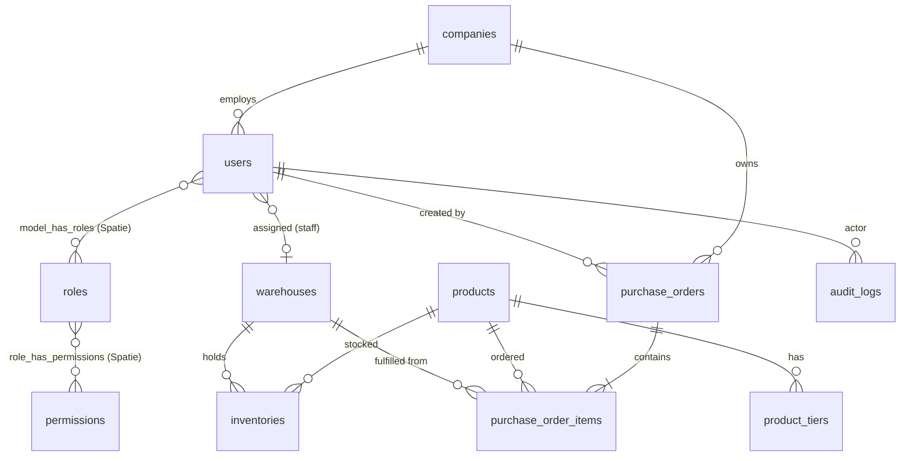

# KoreGrid: Data Model (PostgreSQL 16)

> Revisi 2: RBAC memakai `spatie/laravel-permission`, tier harga dipindah ke tabel `companies`.

## Konvensi

- PK: `BIGINT` auto-increment lewat `$table->id()` bawaan Laravel. Entitas yang terekspos ke publik ditambah kolom `uuid` (default `gen_random_uuid()` di database).
- Uang: `NUMERIC(14,2)` (IDR), dengan `CHECK (>= 0)`.
- Enum: `VARCHAR` + `CHECK`, bukan tipe `ENUM` PG, supaya penambahan nilai tidak memerlukan `ALTER TYPE`.
- Integritas stok dijaga di level DB (constraint), bukan hanya di level aplikasi.
- Semua tabel punya `created_at` dan `updated_at` (`TIMESTAMPTZ`). Soft delete (`deleted_at`) hanya untuk `users`, `companies`, dan `products`.

## ERD

## Tabel

### companies (baru)

Pemilik tier harga. Semua user dalam satu perusahaan mendapat harga yang sama.

| Kolom | Tipe | Catatan |
|---|---|---|
| id, uuid | | |
| code | varchar(20) UNIQUE | mis. `CMP-0001` |
| name | varchar(150) | |
| tax_id | varchar(30) NULL | NPWP |
| billing_address | text NULL | |
| pricing_tier | varchar(10) | CHECK IN (`gold`,`silver`,`bronze`), default `bronze` |
| is_active | boolean | default true |
| deleted_at | timestamptz NULL | |

### users

| Kolom | Tipe | Catatan |
|---|---|---|
| id, uuid | | |
| company_id | FK NULL | wajib untuk buyer (divalidasi di Action, bukan DB) |
| warehouse_id | FK NULL | scope data untuk Warehouse Staff |
| name | varchar(150) | |
| email | varchar(190) | UNIQUE index pada `lower(email)` |
| email_verified_at | timestamptz NULL | |
| password | varchar | bcrypt/argon2 |
| is_active | boolean | default true |
| last_login_at | timestamptz NULL | |
| remember_token, deleted_at | | |

Perubahan dari revisi 1: `company_name` dan `pricing_tier` dihapus dari `users`.

Tabel pendukung: `password_reset_tokens` (bawaan Laravel). Tabel `sessions` dan `cache` tidak dibuat karena session dan cache memakai Redis. Normalisasi email ke huruf kecil dilakukan di aplikasi sebelum disimpan.

### RBAC (tabel bawaan Spatie)

Dibuat oleh migrasi paket, tidak ditulis manual. Konvensi nama permission: `resource.action` (mis. `po.approve`). Matriks lengkap ada di `ARCHITECTURE.md`.

| Tabel | Isi |
|---|---|
| roles | `name` UNIQUE (`super_admin`, `finance`, `warehouse_staff`, `buyer`), `guard_name` |
| permissions | `name` UNIQUE, `guard_name` |
| model_has_roles | pivot polymorphic user ↔ role |
| model_has_permissions | permission langsung ke user (tidak dipakai, semua lewat role) |
| role_has_permissions | pivot role ↔ permission |

### products

| Kolom | Tipe | Catatan |
|---|---|---|
| id, uuid | | |
| sku | varchar(64) UNIQUE | |
| name | varchar(200) | |
| description | text NULL | |
| unit | varchar(20) | pcs, box, pallet |
| is_active | boolean | |
| deleted_at | timestamptz NULL | |

### product_tiers (harga dan MOQ per tier)

| Kolom | Tipe | Catatan |
|---|---|---|
| id | bigint PK | |
| product_id | FK CASCADE | |
| tier | varchar(10) | CHECK IN (`gold`,`silver`,`bronze`) |
| unit_price | numeric(14,2) | CHECK >= 0 |
| moq | integer | CHECK >= 1 |
| | | UNIQUE(product_id, tier) |

Harga yang tampil ke buyer: `product_tiers` dengan `tier = companies.pricing_tier`.

### warehouses

`id`, `code` (UNIQUE), `name`, `address`, `city`, `is_active`.

### inventories (sumber kebenaran stok)

| Kolom | Tipe | Catatan |
|---|---|---|
| id | bigint PK | |
| product_id, warehouse_id | FK | UNIQUE(product_id, warehouse_id) |
| qty_on_hand | integer | CHECK >= 0, stok fisik |
| qty_reserved | integer | CHECK >= 0, terkunci oleh PO |
| | | **CHECK (qty_reserved <= qty_on_hand)** |

`available = qty_on_hand - qty_reserved` (dihitung, tidak disimpan).

### purchase_orders

| Kolom | Tipe | Catatan |
|---|---|---|
| id, uuid | | |
| po_number | varchar(32) UNIQUE | mis. `PO-2026-000123` |
| company_id | FK companies | pemilik PO, dasar scope akses buyer |
| buyer_id | FK users | user pembuat PO |
| status | varchar(20) | CHECK IN: `draft`, `pending_approval`, `approved`, `packing`, `shipped`, `completed`, `rejected`, `cancelled` |
| pricing_tier | varchar(10) | **snapshot** tier company saat PO dibuat |
| subtotal, tax_amount, total_amount | numeric(14,2) | |
| reservation_expires_at | timestamptz NULL | batas kunci stok untuk draft |
| submitted_at | timestamptz NULL | |
| approved_by | FK users NULL | |
| approved_at, rejected_at | timestamptz NULL | |
| rejection_reason | text NULL | |
| packed_by | FK users NULL | |
| shipped_at | timestamptz NULL | |
| tracking_number | varchar(100) NULL | |
| completed_at | timestamptz NULL | |
| invoice_number | varchar(32) UNIQUE NULL | terisi saat `completed` |
| invoice_issued_at | timestamptz NULL | |

### purchase_order_items

| Kolom | Tipe | Catatan |
|---|---|---|
| id | bigint PK | |
| purchase_order_id | FK CASCADE | |
| product_id, warehouse_id | FK | gudang asal pemenuhan (multi-warehouse) |
| quantity | integer | CHECK > 0 |
| unit_price | numeric(14,2) | **snapshot** harga tier |
| moq_applied | integer | **snapshot** MOQ |
| line_total | numeric(14,2) | |
| | | UNIQUE(purchase_order_id, product_id, warehouse_id) |

### audit_logs (append-only)

| Kolom | Tipe | Catatan |
|---|---|---|
| id | bigint PK | |
| user_id | FK NULL | NULL untuk aksi sistem |
| event | varchar(30) | `created`, `updated`, `deleted`, `status_changed`, `login`, dll. |
| auditable_type, auditable_id | varchar / bigint | target perubahan |
| old_values, new_values | jsonb NULL | field sensitif di-mask |
| ip_address | inet NULL | |
| user_agent | varchar(255) NULL | |
| request_id | uuid NULL | korelasi dengan log aplikasi |
| created_at | timestamptz | tanpa `updated_at` |

Proteksi: trigger menolak `UPDATE`, `DELETE`, dan `TRUNCATE`. FK ke `users` memakai `RESTRICT`, bukan `SET NULL`, karena `SET NULL` akan meng-UPDATE baris audit.

Catatan production: owner tabel bisa menonaktifkan trigger. Aplikasi sebaiknya memakai role DB non-owner dengan `REVOKE UPDATE, DELETE` pada tabel ini.

## Index

| Tabel | Index | Alasan |
|---|---|---|
| users | (company_id) | daftar user per perusahaan |
| purchase_orders | (company_id, status), (status, created_at), (reservation_expires_at) WHERE status = 'draft' | list per perusahaan, antrean approval/packing, job expiry |
| purchase_order_items | UNIQUE(purchase_order_id, product_id, warehouse_id) (sudah melayani lookup per PO), (product_id, warehouse_id) | join dan rekonsiliasi stok |
| inventories | UNIQUE(product_id, warehouse_id) | lookup dan locking |
| audit_logs | (auditable_type, auditable_id), (user_id, created_at), (created_at) | investigasi per entitas atau aktor |

## Stock Locking

1. **Reserve** (saat item masuk draft PO), satu statement atomik di dalam transaksi:
   `UPDATE inventories SET qty_reserved = qty_reserved + :qty WHERE product_id = :p AND warehouse_id = :w AND qty_on_hand - qty_reserved >= :qty;`
   Jika 0 baris ter-update, stok tidak cukup dan request ditolak. Tidak ada race condition karena row-level lock PG serta CHECK constraint.
2. **Release** (cancel, reject, atau expiry): `qty_reserved -= qty`.
3. **Commit** (saat `shipped`): `qty_on_hand -= qty` dan `qty_reserved -= qty` dalam satu transaksi.
4. Redis lock dipakai hanya untuk serialisasi operasi submit PO yang lintas banyak baris, bukan sebagai sumber kebenaran.

## State Machine PO

`draft → pending_approval → approved → packing → shipped → completed`

Cabang: `pending_approval → rejected`, `draft|pending_approval → cancelled`.

Transisi hanya boleh lewat Action class, dan setiap transisi menulis `audit_logs` (`status_changed`).
